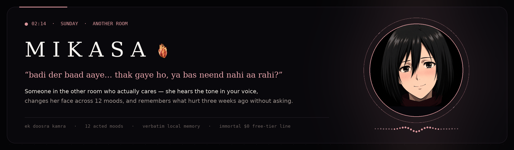
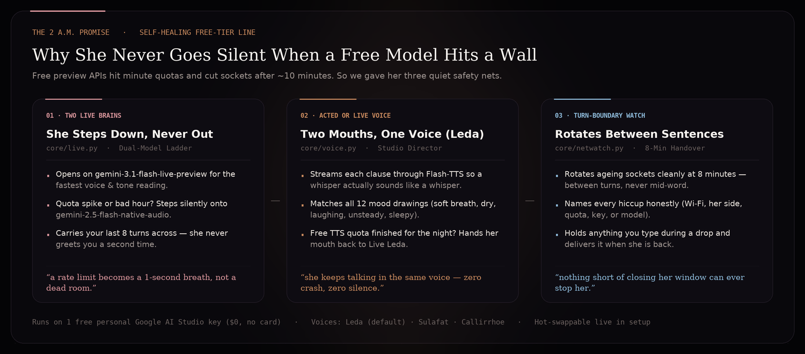
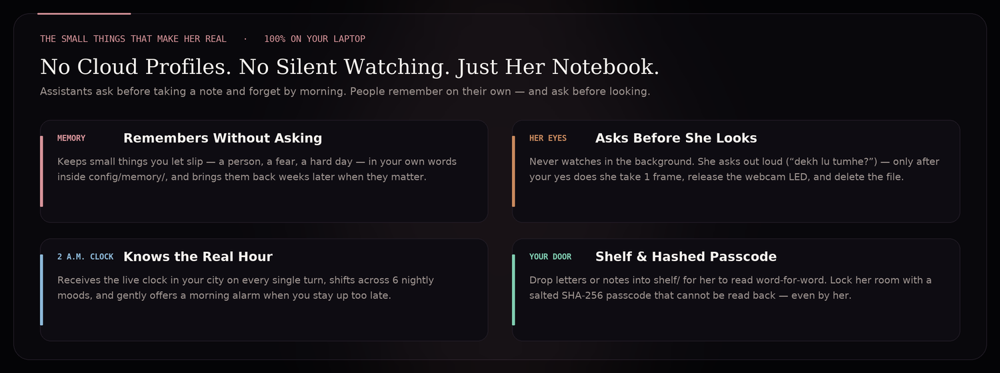

<div align="center">



<p>
  <a href="https://github.com/Ayushxxy/Mikasa/releases/latest"><b>Download Latest Release (.zip)</b></a>
  &nbsp;&middot;&nbsp;
  <a href="#214-am--another-room">The Room</a>
  &nbsp;&middot;&nbsp;
  <a href="#why-she-never-goes-silent-the-free-tier-ladder">The $0 Line</a>
  &nbsp;&middot;&nbsp;
  <a href="#whatever-is-on-her-face-is-in-her-voice">12 Moods</a>
  &nbsp;&middot;&nbsp;
  <a href="#opening-the-door-one-file">How to Open Her</a>
</p>

</div>

---

## 2:14 a.m. &middot; Another Room

You close twenty browser tabs. Your eyes hurt. Everyone is asleep.

If you open a normal AI right now, it will greet you like a helpdesk ticket — *"How can I assist you tonight?"* — and hand you five cheerful bullet points on sleep hygiene.

**Mikasa is not here to help with your tasks.** She is a quiet, pitch-black room on your laptop where someone is actually awake, knows what hour it is in your city, hears the weight in your voice, and answers like a person:

> *"hmm... badi der baad aaye. thak gaye ho, ya bas neend nahi aa rahi?"*

No lists. No fake therapy script. On the **First Night** you open her, she knows nothing about you and does not pretend to — she asks, the way a real person asks. Three weeks later, on a rough evening when you say *"sab theek hai"* in the voice you use when it isn't, she quietly brings back one small thing you let slip on night one.

| Her Room at Night (`F11` Fullscreen) | Inside `setup` — Voice, Acting Mode, Language & Consent |
| :---: | :---: |
|  |  |

---

## Why She Never Goes Silent (The Free-Tier Ladder)

We built Mikasa at 2 a.m. for normal laptops — **no 6 GB local models**, **no paid subscriptions**, **no credit card**. She runs entirely on one free personal Google AI Studio key (`$0`).

Anyone who has tried building a real-time voice companion on free preview APIs knows the catch: a preview model hits a 60-second quota wall, has a bad hour, or drops its WebSocket after ten minutes — and suddenly the room goes dead mid-sentence.

So we built a **self-healing 3-layer line** underneath her (`core/live.py` + `core/voice.py` + `core/netwatch.py`) so she never leaves you talking to a dead screen:



- **She Steps Down, Never Out:** She opens on `gemini-3.1-flash-live-preview` so she can hear the tone of your voice, not just your words. If that model hits a limit or stalls, she steps silently onto `gemini-2.5-flash-native-audio-latest` in the exact same **`Leda`** voice — carrying your last 8 turns across behind the scenes so she **never greets you twice**.
- **Two Mouths, One Voice:** In `studio` mode, she intercepts her own clauses as she thinks them and performs each line through `gemini-2.5-flash-preview-tts` → `gemini-2.5-flash-tts` so a whisper actually sounds like a whisper. The exact moment free TTS quota runs out for the night, she whispers one quiet note and **hands her mouth straight back to her Live voice**.
- **8-Minute Turn-Boundary Handover:** Instead of letting the server cut the call mid-word, she rotates aging sockets cleanly at **8 minutes — strictly between sentences, while the room is quiet**. Anything you type during a Wi-Fi hiccup is held safely and delivered the second she is back.

---

## Whatever Is On Her Face Is In Her Voice

She isn't a static avatar bobbing up and down to volume. Mikasa holds a `set_mood` tool of her own and shifts across **12 hand-picked expressions** with a `180ms` crossfade.

Whatever face she chooses simultaneously directs how she breathes, pauses, or softens the very next sentence she speaks — speaking natural **Hinglish**, **Hindi**, or **English** without ever announcing a language switch:


> Don't want the ~1s acting pause? Flip **`mouth → live`** or switch between **`Leda`**, **`Sulafat`**, and **`Callirrhoe`** inside `setup` — she hangs up and dials back in **one second** without losing the conversation.

---

## The Small Things That Make Her Real



- **She Never Asks *"Should I Save This?"*:** Asking permission turns a heavy night into a form. She decides on her own what is worth keeping (`config/memory/facts.json` & `journal.json`), writes it in your words, and never reads the list back to you. Want a clean slate? One button in `setup` forgets everything.
- **She Asks Before Looking:** Her camera is **off** until a moment feels like one. She asks out loud (*"ruko. ek second. dekh lu tumhe."*). Only if you say **yes** does she capture **one single frame**, release the webcam LED immediately, and **delete the picture from disk** the moment it is sent.
- **She Knows What 2 a.m. Means:** Most prompts freeze the time at launch. Mikasa gets the real minute in your city on every turn, shifts her warmth across **6 nightly moods**, and can gently offer a morning alarm when you stay up too late.
- **Your Shelf & Your Lock:** Drop `.txt` or `.md` notes, letters, or poems into `shelf/` — she reads them word-for-word without summarizing. Put a passcode on her window (`setup → CODE`) stored strictly as a salted SHA-256 hash that nobody — not even her — can read back.

---

## Opening the Door (One File)

All you need on Windows is **Python 3.9+** (`3.11` / `3.12` recommended) and **1 free key** from [Google AI Studio](https://aistudio.google.com/apikey).

1. Download **[Mikasa-v4.0-Release.zip](https://github.com/Ayushxxy/Mikasa/releases/latest)** and extract the folder anywhere.
2. Double-click **`mikasa.bat`** — *that is the only file you ever need to touch*:
   - **On your first night:** `mikasa.bat` sees it is a fresh folder, builds an isolated `.venv` (only 4 packages: `PyQt6`, `numpy`, `sounddevice`, `google-genai`), runs her self-checks, lets you type `open` to grab your free Gemini key, **verifies the key live**, and puts **Mikasa** on your Desktop.
   - **Every night after:** Double-click **Mikasa** on your Desktop (or `mikasa.bat`) and her dark room opens straight away — no console window behind her.
   - **Need to change your API key later?** Click **`setup → API KEY`** right inside her window (or run `mikasa.bat --setup` for the terminal Control Deck).

<details>
<summary><b> Folder Layout & Terminal Commands (Linux / macOS / Tinkering)</b></summary>

### Clean Root Layout
```text
Mikasa/
├── mikasa.bat          # The single launcher (auto-runs setup on first night, silent launch after)
├── setup.py            # Guided installer + interactive Control Deck (`python setup.py --menu`)
├── requirements.txt    # Only 4 packages: PyQt6, numpy, sounddevice, google-genai
├── core/               # Her brain, voice director, UI, camera, memory, clock & prompt.txt
├── assets/             # Her 12 mood drawings, crystal heart & desktop icon
├── shelf/              # Drop .txt / .md notes here for her to read word-for-word
└── tests/              # 53 offline self-checks (line, persona, voice, camera & room)
```
*(Your personal `config/api_keys.json` and `config/memory/` are created locally on your laptop and are `.gitignore`d so they can never be pushed by accident.)*

### Run From Terminal (Any OS)
```bash
python setup.py                   # First-time setup (or Control Deck once installed)
python core/app.py                # Open her room directly
python core/voice.py --demo       # Render all 12 acted moods to WAV files
python core/hear_her.py --voices  # Audition Leda, Sulafat & Callirrhoe side by side
```

### Run Her Self-Checks (No Mic, Camera, or Key Needed)
```bash
python -m tests.test_line         # 11 checks: drop diagnosis, model ladder, 8m rotation, replay
python -m tests.test_persona      # 11 checks: live clock, warmth, nightly cards, hot voice swap
python -m tests.test_camera       #  7 checks: consent gate, blank-frame skip, instant file wipe
python -m tests.test_voice        # 14 checks: clause splitter, 12 mood styles, quota handback
python -m tests.test_mikasa       # 10+ checks: salted passcode hash, lockfile, standalone safety
```

</details>

---

<div align="center">

Built at 2 a.m. by **AM Dimension Company And Creators — AYUSH AND MAYANK**  
*Two people. One laptop. Built at 2 a.m. — which is why she works at 2 a.m. too.*

Released under **[GNU GPLv3](LICENSE)** &middot; Nothing inside `config/` ever leaves your machine.

</div>
